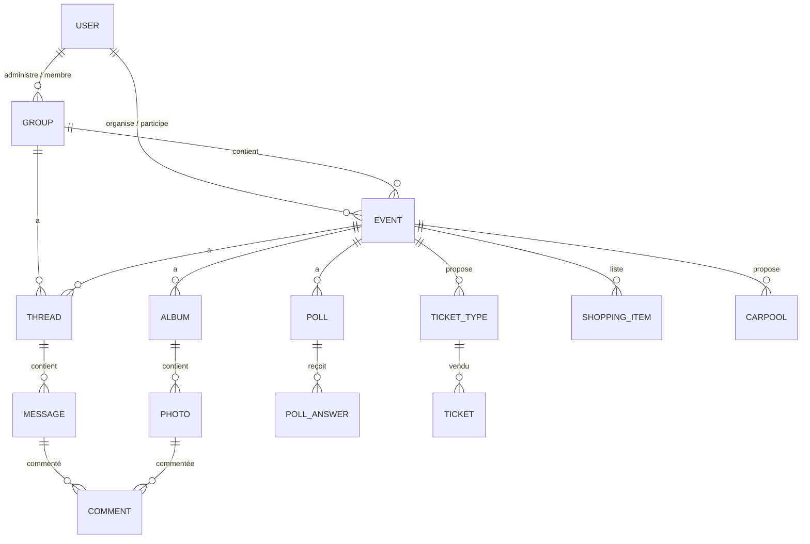

# Social Networks API

API REST pour la refonte des services Facebook : **utilisateurs, événements, groupes, fils de discussion, albums photo, sondages, billetterie, shopping list et covoiturage (bonus)**.

- **Stack** : Node.js 18+ · Express 5 · MongoDB · Mongoose
- - **Documentation Postman publiée** : https://documenter.getpostman.com/view/29685962/2sBYHbrbT4
- **Collection Postman** : [`docs/social-networks-api.postman_collection.json`](docs/social-networks-api.postman_collection.json) (131 requêtes documentées, avec exemples de réponses réelles et tests automatiques)

---

## 1. Installation et lancement

```bash
git clone https://github.com/Ilian734/social-networks-api.git
cd social-networks-api
npm install
cp .env.example .env      # puis adapter MONGO_URI si besoin
npm start                 # ou: npm run dev (rechargement automatique)
```

L'API écoute sur `http://localhost:3000/api` (MongoDB doit tourner sur `mongodb://127.0.0.1:27017`).

| Variable | Défaut | Rôle |
|---|---|---|
| `PORT` | `3000` | Port HTTP |
| `MONGO_URI` | `mongodb://127.0.0.1:27017/social_networks` | Connexion MongoDB |
| `POSTMAN_DOC_URL` | — | URL de la doc, renvoyée par `GET /` |

### Tester avec Postman

1. Postman → **Import** → `docs/social-networks-api.postman_collection.json`.
2. Vérifier la variable de collection `baseUrl` (`http://localhost:3000/api`).
3. Clic droit sur la collection → **Run collection** : toutes les requêtes s'enchaînent (création des données, sauvegarde automatique des ids dans les variables, vérification des codes HTTP, nettoyage final).

En ligne de commande : `npx newman run docs/social-networks-api.postman_collection.json`

### Publier la documentation Postman

Collection → **⋯** → **View documentation** → **Publish** → copier l'URL publique et la coller en haut de ce README (et dans `POSTMAN_DOC_URL`).

### Régénérer la collection

`docs/build-postman.js` exécute chaque requête contre l'API lancée et réécrit la collection avec les vraies réponses (sert aussi de test de bout en bout) :

```bash
npm start            # terminal 1
npm run postman:build   # terminal 2 -> "131/131 requêtes conformes"
```

---

## 2. Architecture

```
src/
├── server.js              # démarrage (connexion Mongo + écoute HTTP)
├── app.js                 # application Express
├── config/db.js
├── routes/index.js        # toutes les routes /api
├── middlewares/
│   ├── auth.js            # identification par header X-User-Id
│   └── errorHandler.js    # format d'erreur unique (400/401/403/404/409/500)
├── models/                # schémas Mongoose + règles de validation
├── controllers/           # logique métier par ressource
└── utils/                 # pagination, permissions, suppressions en cascade…
docs/
├── build-postman.js       # générateur + test E2E de la collection
└── social-networks-api.postman_collection.json
```

### Conventions

- **Authentification simplifiée** : l'utilisateur qui agit est identifié par le header `X-User-Id`. Requis pour toute écriture (sauf création de compte et achat de billet). Facilement remplaçable par un JWT sans toucher aux contrôleurs (`req.userId`).
- **Listes paginées** : `?page=1&limit=20` (max 100) → `{ data, pagination: { page, limit, total, pages } }`.
- **Erreurs** : `{ "error": { "status", "message", "details?" } }`.
- **Performances** : index MongoDB sur toutes les clés de recherche, requêtes `lean()`, listes sans les tableaux lourds (participants / membres), comptages en parallèle, décrément **atomique** des billets.

---

## 3. Modèle de données



| Ressource | Attributs principaux (* obligatoire) |
|---|---|
| **User** | firstname*, lastname*, email* (unique), password* (hashé, ≥ 8 car.), birthdate, phone, avatar, bio, address |
| **Event** | name*, description, startDate*, endDate* (> début), location*, coverPhoto, visibility (public/private), organizers (≥ 1), participants, group, ticketingEnabled, shoppingListEnabled, carpoolEnabled |
| **Group** | name*, description, icon, coverPhoto, type (public/private/secret), allowMembersToPost, allowMembersToCreateEvents, admins (≥ 1), members |
| **Thread** | title, group **xor** event, createdBy |
| **Message** | thread, author, content* |
| **Comment** | targetType (Message/Photo), target, author, content* |
| **Album** | event*, name*, description, createdBy |
| **Photo** | album, author, url*, caption |
| **Poll** | event*, title*, createdBy, questions* [{ text, options [{ text }] (≥ 2) }] (≥ 1) |
| **PollAnswer** | poll, user, answers [{ question, option }] |
| **TicketType** | event, name*, amount*, quantity*, sold, remaining |
| **Ticket** | event, ticketType*, buyer { firstname*, lastname*, email*, address { street, zipcode, city, country }* }, purchaseDate |
| **ShoppingItem** | event, user, name* (unique par événement), quantity*, arrivalTime* |
| **Carpool** | event, driver, departurePlace*, departureTime*, price*, seats*, maxDetourMinutes*, passengers |

---

## 4. Endpoints

Base : `/api`. 🔐 = header `X-User-Id` requis.

### Utilisateurs
| Méthode | URL | Description |
|---|---|---|
| GET | `/users?search=` | Liste paginée |
| POST | `/users` | Créer un compte (email unique → 409) |
| GET | `/users/:id` | Détail |
| PATCH 🔐 | `/users/:id` | Modifier son compte |
| DELETE 🔐 | `/users/:id` | Supprimer son compte |
| GET | `/users/:id/events` | Événements de l'utilisateur |
| GET | `/users/:id/groups` | Groupes de l'utilisateur |

### Événements
| Méthode | URL | Description |
|---|---|---|
| GET | `/events?visibility=&group=&user=&upcoming=true&search=` | Liste paginée |
| POST 🔐 | `/events` | Créer (le créateur devient organisateur) |
| GET | `/events/:id` | Détail (organisateurs, participants) |
| PATCH 🔐 / DELETE 🔐 | `/events/:id` | Organisateurs uniquement (suppression en cascade) |
| GET | `/events/:id/participants` | Organisateurs + participants |
| POST 🔐 | `/events/:id/participants` | Rejoindre (public) ou inviter `{ userId }` (organisateur) |
| DELETE 🔐 | `/events/:id/participants/:userId` | Quitter / retirer |
| POST 🔐 / DELETE 🔐 | `/events/:id/organizers[/:userId]` | Gérer les organisateurs (≥ 1) |
| GET 🔐 | `/events/:id/share` | Liens de partage réseaux sociaux |

### Groupes
| Méthode | URL | Description |
|---|---|---|
| GET | `/groups?type=&member=&search=` | Liste (groupes secrets masqués) |
| POST 🔐 | `/groups` | Créer (créateur admin + fil de discussion auto) |
| GET | `/groups/:id` | Détail |
| PATCH 🔐 / DELETE 🔐 | `/groups/:id` | Admins uniquement |
| POST 🔐 / DELETE 🔐 | `/groups/:id/members[/:userId]` | Rejoindre / ajouter / retirer |
| POST 🔐 / DELETE 🔐 | `/groups/:id/admins[/:userId]` | Gérer les admins (≥ 1) |
| GET | `/groups/:id/events` | Événements du groupe |
| POST 🔐 | `/groups/:id/events` | Créer un événement en **invitant tous les membres** |
| GET | `/groups/:id/threads` | Fils du groupe |

### Fils de discussion
| Méthode | URL |
|---|---|
| GET `?group=` ou `?event=` · POST 🔐 | `/threads` |
| GET · PATCH 🔐 · DELETE 🔐 | `/threads/:threadId` |
| GET · POST 🔐 | `/threads/:threadId/messages` |
| GET · PATCH 🔐 · DELETE 🔐 | `/threads/:threadId/messages/:messageId` |
| GET · POST 🔐 | `/threads/:threadId/messages/:messageId/comments` |
| GET · PATCH 🔐 · DELETE 🔐 | `/threads/:threadId/messages/:messageId/comments/:commentId` |

### Albums photo
| Méthode | URL |
|---|---|
| GET `?event=` · POST 🔐 | `/albums` |
| GET · PATCH 🔐 · DELETE 🔐 | `/albums/:albumId` |
| GET · POST 🔐 | `/albums/:albumId/photos` |
| GET · PATCH 🔐 · DELETE 🔐 | `/albums/:albumId/photos/:photoId` |
| GET · POST 🔐 | `/albums/:albumId/photos/:photoId/comments` |
| GET · PATCH 🔐 · DELETE 🔐 | `/albums/:albumId/photos/:photoId/comments/:commentId` |

### Sondages
| Méthode | URL |
|---|---|
| GET `?event=` · POST 🔐 | `/polls` |
| GET · PATCH 🔐 · DELETE 🔐 | `/polls/:pollId` |
| GET | `/polls/:pollId/results` |
| GET · POST 🔐 | `/polls/:pollId/answers` |
| GET · PATCH 🔐 · DELETE 🔐 | `/polls/:pollId/answers/:answerId` |

### Billetterie
| Méthode | URL |
|---|---|
| GET · POST 🔐 | `/events/:eventId/ticket-types` |
| GET · PATCH 🔐 · DELETE 🔐 | `/events/:eventId/ticket-types/:ticketTypeId` |
| POST (public) · GET 🔐 | `/events/:eventId/tickets` |
| GET 🔐 · PATCH 🔐 · DELETE 🔐 | `/events/:eventId/tickets/:ticketId` |

### Shopping list
| Méthode | URL |
|---|---|
| GET · POST 🔐 | `/events/:eventId/shopping-items` |
| GET · PATCH 🔐 · DELETE 🔐 | `/events/:eventId/shopping-items/:itemId` |

### Covoiturage (bonus)
| Méthode | URL |
|---|---|
| GET `?maxPrice=&minSeats=` · POST 🔐 | `/events/:eventId/carpools` |
| GET · PATCH 🔐 · DELETE 🔐 | `/events/:eventId/carpools/:carpoolId` |
| POST 🔐 | `/events/:eventId/carpools/:carpoolId/passengers` |
| DELETE 🔐 | `/events/:eventId/carpools/:carpoolId/passengers/:userId` |

---

## 5. Règles du cahier des charges et leur implémentation

| Exigence | Implémentation |
|---|---|
| Pas 2 utilisateurs avec le même email | index unique + vérification → 409 |
| Événement : 1..n organisateurs, n participants | validation `organizers.length ≥ 1`, impossible de retirer le dernier |
| Visibilité public / privé | événement privé : participants ajoutés uniquement par un organisateur ; contenus réservés aux membres |
| Groupe public / privé / secret | adhésion libre si public ; ajout par admin sinon ; secrets masqués des listes |
| Groupe : 1..n membres, 1..n admins | un admin est toujours membre, ≥ 1 admin garanti |
| Inviter tous les membres en 1 clic | `POST /groups/:id/events` avec `inviteAllMembers` |
| Autoriser les membres à publier / créer des événements | `allowMembersToPost`, `allowMembersToCreateEvents` vérifiés |
| Partage sur les réseaux (groupe public) | `GET /events/:id/share` |
| Fil de discussion dans chaque groupe | créé automatiquement avec le groupe |
| Fil lié à 1 groupe **ou** 1 événement | validation XOR → 400 |
| Commentaires par membres / participants | contrôles de permissions |
| Album lié à 1 événement, photos par participants | contrôles de permissions |
| Sondage créé par un organisateur, ≥ 1 question, 1 seule réponse par question | validations + 400 / 403 / 409 |
| Billetterie (événements publics), types de billets, quantité limitée | `ticketingEnabled` réservé au public, décrément atomique → 409 si épuisé |
| 1 seul billet par personne extérieure | index unique (événement, email) → 409 |
| Billet : type, nom, prénom, adresse complète, date d'achat | schéma `Ticket` |
| Shopping list activable, élément unique par événement | `shoppingListEnabled` + nom normalisé unique → 409 |
| Covoiturage activable (bonus) | `carpoolEnabled`, gestion des places et passagers |
